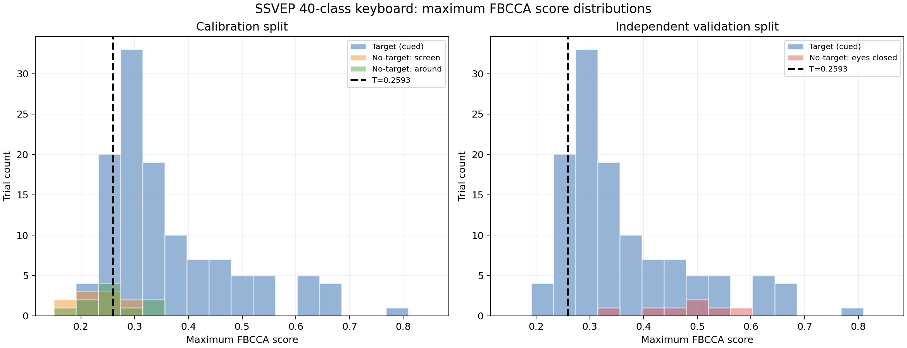

# SSVEP 40 分类键盘离线 FBCCA 阈值分析

## 结论

按预先固定的数据划分，先用 Youden J 校准最高分阈值 **T = 0.259346**，再校准独立的 alpha 相对能量阈值 **A = 2.763172**；自由输入只有同时满足 `max_score >= T` 和 `alpha_ratio <= A` 才提交字符。alpha 门控校准集 TPR=85.0%、FPR=15.0%、J=0.700。

这次已把分数阈值和 alpha 意图门控接入自由输入拒识入口；FBCCA 分类器本身未修改。当前闭眼验证为 0/7 误接受，但样本量很小，上线前仍需要新的独立会话复测。

## 数据与复算

- `注视目标.zip`：120 个有目标试次，3 区组×40，标签为 1–40；每类每区组各 1 次。
- 另三个 ZIP：自由模式、标签为 `-1`；实际有 EEG 的试次分别为 10、10、7，未把最后缺 EEG 的试次当作分数。
- 对 147 个有 EEG 的试次重新调用项目现有 `classify_eeg_window`；重新计算分数与 ZIP 中保存的 `fbcca_scores` 最大绝对差为 0。
- 参数沿用会话：5 s 窗、250 Hz、3 次谐波、m3_5band、a=1.25、b=0.25、50 Hz notch、8 个通道。
- LSL 元数据声明 16 通道 `obci_eeg1`，分析选取索引 0–7；通道单位均为 `UNKNOWN`，且四个会话元数据都记录了 50 Hz 附近高能量提示，因此结果应视为本次采集条件下的离线证据。
- 项目中另有两个 2026-10-01 的 `standard_2s` 会话 ZIP；它们不是本次四个 5 s 数据包，未与当前阈值校准混合。

## 分数分布

| 数据 | n | 最小 | 中位数 | 均值 | 最大 |
|---|---:|---:|---:|---:|---:|
| Target (cued) | 120 | 0.2091 | 0.3186 | 0.3641 | 0.7923 |
| No-target: screen | 10 | 0.1859 | 0.2289 | 0.2324 | 0.2922 |
| No-target: around | 10 | 0.1811 | 0.2528 | 0.2530 | 0.3345 |
| No-target: eyes closed | 7 | 0.3300 | 0.4834 | 0.4719 | 0.5851 |

## 阈值校准与独立验证

分数阈值校准集：有目标区组 1–2（n=80）+ 无目标‘看屏幕不专注’和‘看周围环境’（n=20）；分数 AUC=0.893。alpha 门控阈值为 A=2.763172。独立验证集：有目标区组 3（n=40）+ 闭眼（n=7）；分数 AUC=0.182。

| 指标 | 校准集 | 独立验证集 |
|---|---:|---:|
| 有目标接受率/TPR（双门控） | 85.0% | 55.0% |
| 无目标误接受率/FPR（双门控） | 15.0% | 0.0% |

## 输入性能

全 120 个有目标试次原始 FBCCA 正确 85/120（70.8%）。双门控后接受 90/120（75.0%），拒绝 30/120（误拒绝率 25.0%）；正确且被接受 68/120（正确输入率按全部目标计 56.7%），在已接受试次中的条件正确率为 75.6%。

无目标每分钟误触发（按 session_start 到 session_end 的墙钟时长计）：

- No-target: screen：2/10，1.38 次/分钟（仅按 5 s 已评分窗折算为 2.40 次/分钟）。
- No-target: around：1/10，0.68 次/分钟（仅按 5 s 已评分窗折算为 1.20 次/分钟）。
- No-target: eyes closed：0/7，0.00 次/分钟（仅按 5 s 已评分窗折算为 0.00 次/分钟）。
- 三个无目标会话合计：3 次/3.95 分钟，即 0.76 次/分钟。

若只使用最高分并要求三个无目标状态全部 0 误触发，阈值必须严格高于无目标最大分数 0.585090；此时有目标仅 10/120（8.3%）超过阈值。当前实现增加 alpha 意图门控，但闭眼验证仍有 0/7 个误接受。

## 生成文件

- `analysis_report.json`：完整统计、逐试次结果、阈值候选和意图门控验证。
- `score_distributions.png`：校准和独立验证分布图。
- `run_analysis.py`：本次离线复算脚本。
